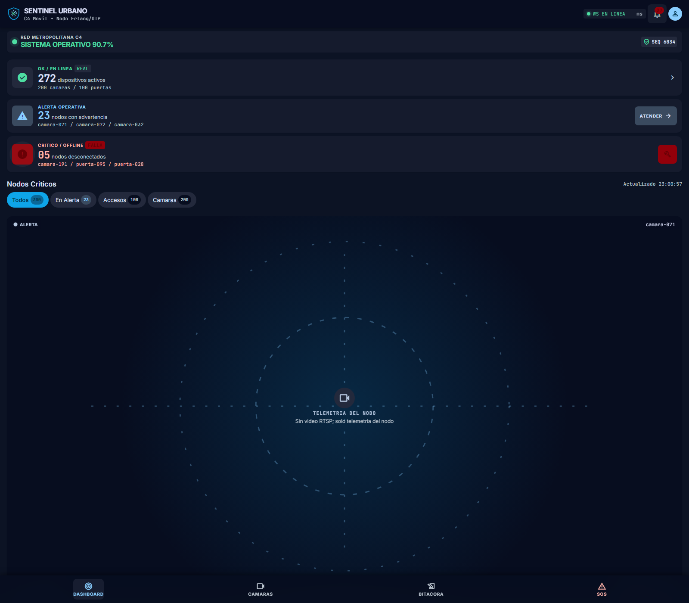
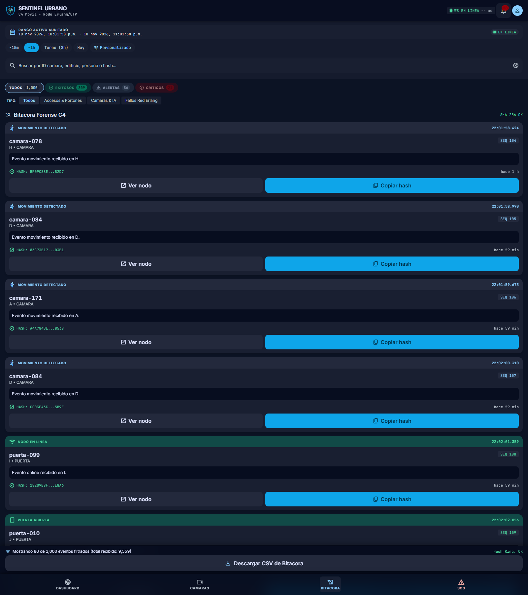

# Evidencias

Indice completo: [`Evidencias/README.md`](Evidencias/README.md).

- [`Evidencias/Pruebas_backend.md`](Evidencias/Pruebas_backend.md): pruebas reales de compilacion, eunit y API.
- [`Evidencias/Capturas.md`](Evidencias/Capturas.md): capturas de la interfaz.
- [`docs/CAOS.md`](docs/CAOS.md): resultados medidos de la prueba de caos.

