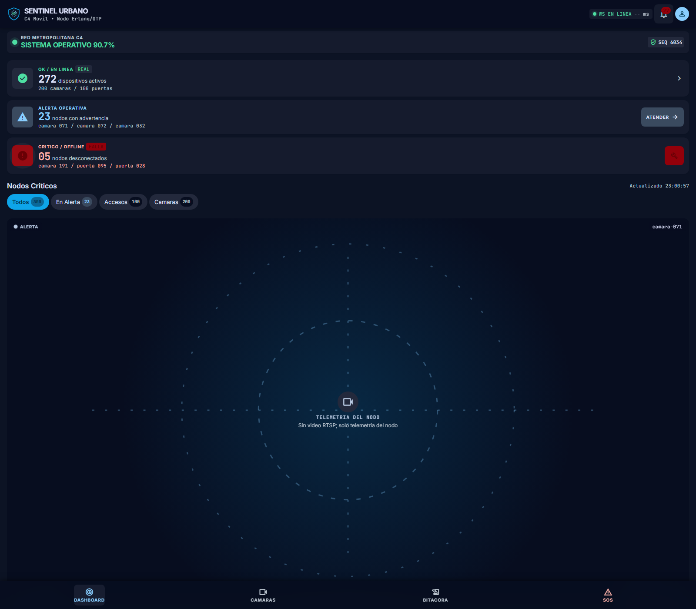
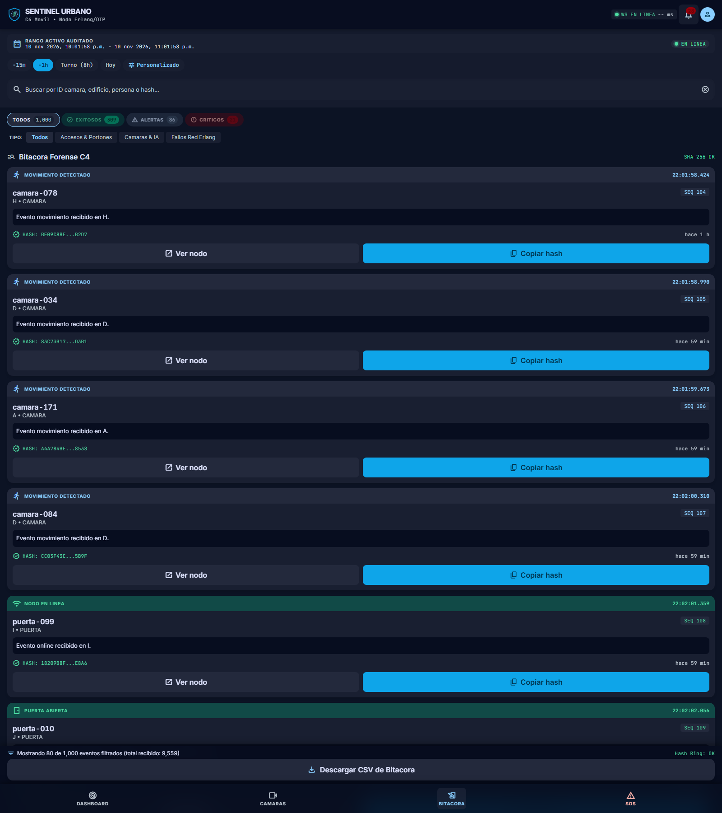
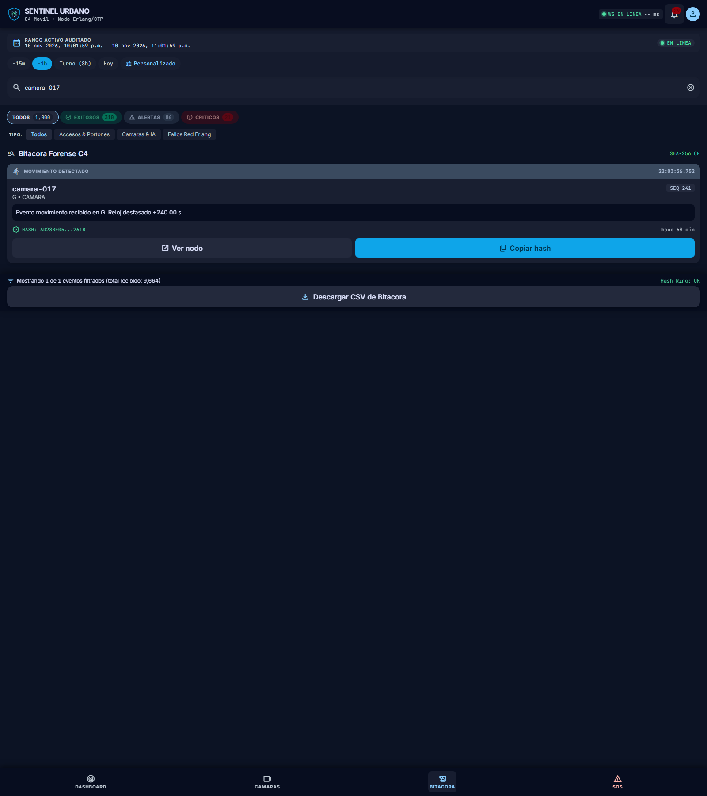
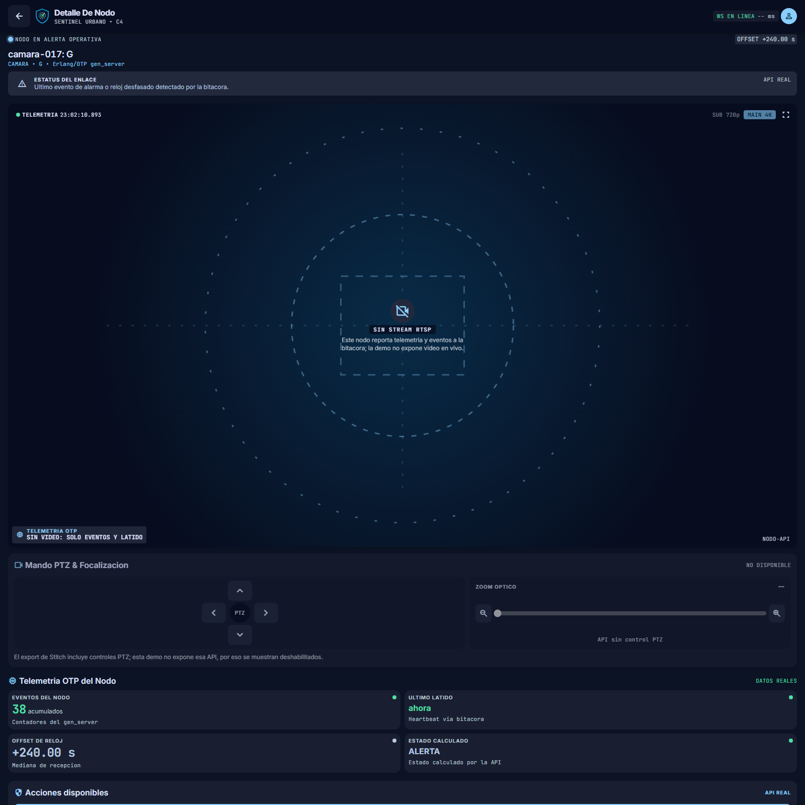

# Evidencias — #69 Camaras y accesos

Evidencia generada ejecutando la app real (release en `_build/prod/rel`) y el
simulador de eventos. No hay capturas fabricadas ni datos inventados.

Fecha de la corrida: 2026-11-11 (UTC).

## Capturas de la UI

| Pantalla | Archivo |
| --- | --- |
| Dashboard en vivo (WebSocket en linea, KPIs y nodos) | [`capturas/dashboard.png`](capturas/dashboard.png) |
| Bitacora con filtros y busqueda | [`capturas/bitacora.png`](capturas/bitacora.png) |
| Bitacora filtrada por `camara-017` | [`capturas/bitacora-camara-017.png`](capturas/bitacora-camara-017.png) |
| Detalle de nodo `camara-017` con reloj desfasado | [`capturas/nodo-camara-017.png`](capturas/nodo-camara-017.png) |









## Pruebas

- [`pruebas/eunit.txt`](pruebas/eunit.txt): salida real de `rebar3 compile` y
  `rebar3 eunit` (51 pruebas, 0 fallos).
- [`pruebas/api.md`](pruebas/api.md): release en ejecucion y respuestas reales de
  `/api/salud`, `/api/dispositivos`, `/api/eventos`, `/api/bitacora/verificar` y
  `/metrics`.
- [`../docs/CAOS.md`](../docs/CAOS.md): resultados medidos de la prueba de caos
  (1,000,000 de eventos, fallos inducidos y recuperacion del WAL).
- [`../docs/SUPUESTOS.md`](../docs/SUPUESTOS.md): supuestos y limites declarados.

## Como se reprodujo

```bash
export PATH="$HOME/.local/opt/erlang-p69/bin:$HOME/.local/bin:$PATH"
rebar3 compile
rebar3 eunit
rebar3 as prod release
scripts/demo.sh --limpiar --puerto 8080
```

Las capturas se tomaron con Chrome headless contra el release real. El detalle
de `camara-017` muestra `estado: alerta` y `offset_segundos: 240` inyectados por
el simulador.
