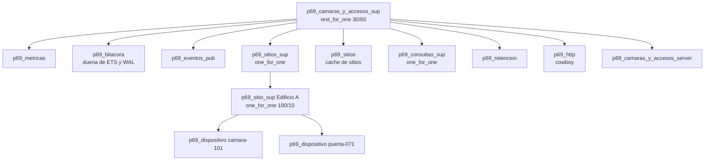

# Diseno OTP — #69 Camaras y accesos

Documento de sustentacion tecnica: procesos, supervisores, estrategias y el
porque de cada decision frente a los casos dificiles del enunciado.

## 1. Arbol de supervision

El supervisor raiz usa `rest_for_one`: si la bitacora (duena de las ETS y del
WAL) cae, se reinician en cadena los procesos que dependen de ella (`sitios`,
`consultas`, `retencion`, `http`). Asi nunca queda un cliente leyendo tablas
muertas. Un fallo de un dispositivo o de una consulta no toca a la bitacora.

## 2. Procesos y responsabilidades

| Modulo | Tipo | Estado que guarda | Por que es un proceso |
|---|---|---|---|
| `p69_bitacora` | gen_server | segmentos ETS, WAL, `seq`, `last_hash`, pines, relojes | unico punto de escritura: serializa la ingesta y la recuperacion |
| `p69_dispositivo` | gen_server | ultimo latido, contadores, offset de reloj, eventos recientes | aislar el estado de cada puerta/camara y reiniciarlo solo |
| `p69_sitio_sup` | supervisor | hijos `p69_dispositivo` del edificio | agrupar fallos por sitio sin afectar a otros edificios |
| `p69_sitios` | gen_server | cache de `edificio -> pid` y dispositivos | ruteo rapido de eventos sin consultar supervisores cada vez |
| `p69_consulta` | worker efimero | iterador de rango y pin de segmentos | una consulta lenta no bloquea la ingesta |
| `p69_retencion` | gen_server | temporizador | borrado periodico independiente de la ingesta |
| `p69_eventos_pub` | gen_server | mapa de suscriptores | fan-out de eventos al WebSocket |
| `p69_metricas` | ETS publica | contadores | instrumentacion barata desde cualquier proceso |
| `p69_http`, `p69_ws` | cowboy | conexiones | API REST, estaticos y WebSocket |

## 3. Ingesta sin perdida

1. `POST /api/eventos` normaliza y valida (`p69_evento`).
2. `p69_bitacora` asigna `seq` monotono y `hash = SHA256(hash_prev || registro)`.
3. Escribe el WAL y hace `sincronizar` **antes** de responder `201` (persistencia
   previa al ACK).
4. Inserta en ETS por segmento y notifica a `p69_eventos_pub`.

Backpressure: si la cola de mensajes supera `ingesta_umbral_429`, la bitacora
responde `{error, sobrecarga}` y el handler devuelve **429** con `Retry-After`;
si nadie consume, la bandera `ingesta_max_cola` corta antes de crecer sin limite.

## 4. Busqueda por rango

- Cada segmento es una tabla ETS `ordered_set` con llave `{ts_corregido, seq}`;
  buscar un rango usa `ets:next` desde la primera llave, sin recorrer toda la
  tabla.
- Indices secundarios por edificio y por dispositivo permiten resolver filtros
  sin escanear.
- La consulta corre en `p69_consulta`, abre pines sobre los segmentos del rango
  y los libera al terminar.

## 5. Casos dificiles

### 5.1 Evento tardio
Se inserta en su posicion por `ts_corregido`; la cadena de hashes sigue el orden
de llegada (`seq`), porque el ACK y el WAL son secuenciales. La verificacion
recalcula por `seq`, no por tiempo.

### 5.2 Reloj desfasado (4 min)
`p69_reloj` estima el offset con la mediana de `ts_recepcion - ts_evento` en las
ultimas muestras. Se guardan ambos tiempos y se marca `desfasado`. La busqueda
usa `ts_corregido`.

### 5.3 Retencion con consultas en curso
`retener` identifica segmentos vencidos. Si un segmento tiene `pin_counts > 0`
responde `en_uso` y no lo borra; al cerrar la consulta se libera el pin y el
siguiente ciclo lo elimina. Cada borrado genera un **checkpoint** encadenado para
que la verificacion siga siendo valida.

### 5.4 Reinicio con eventos en memoria
Al arrancar, la bitacora relee el WAL, reconstruye segmentos/ETS, aplica
checkpoints y restaura `seq`/`last_hash`. `p69_sitios` reconstruye el ultimo
evento por dispositivo desde la bitacora con `ultimos_por_dispositivo/0`.

## 6. Verificacion de integridad

`/api/bitacora/verificar` recorre el libro de hashes por `seq`, recalcula la
cadena y compara. Responde `200` con `integridad: "ok"` o `409` si detecta un
eslabon roto o un evento alterado. Los checkpoints de retencion se encadenan
aparte.

## 7. Limites conocidos

- El WAL no se trunca; el arranque con millones de eventos es lineal.
- El libro de hashes conserva una entrada por evento para poder verificar tras
  la retencion.
- El reinicio de un dispositivo pierde estado efimero (contadores y eventos
  recientes), no los eventos de la bitacora.
- No hay API de control fisico ni PTZ; la UI no finge esas acciones.
